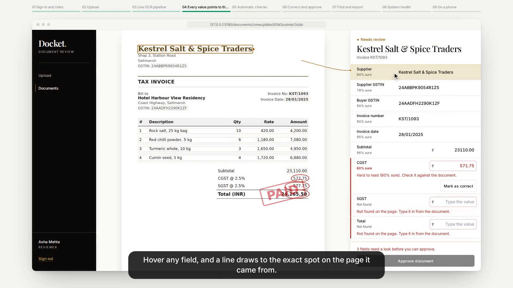
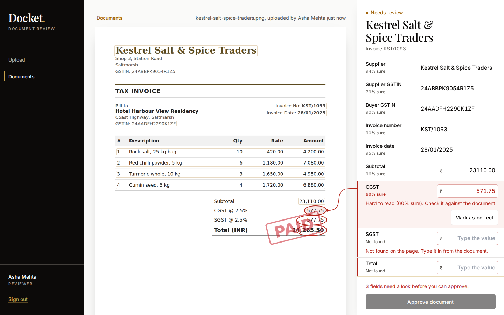
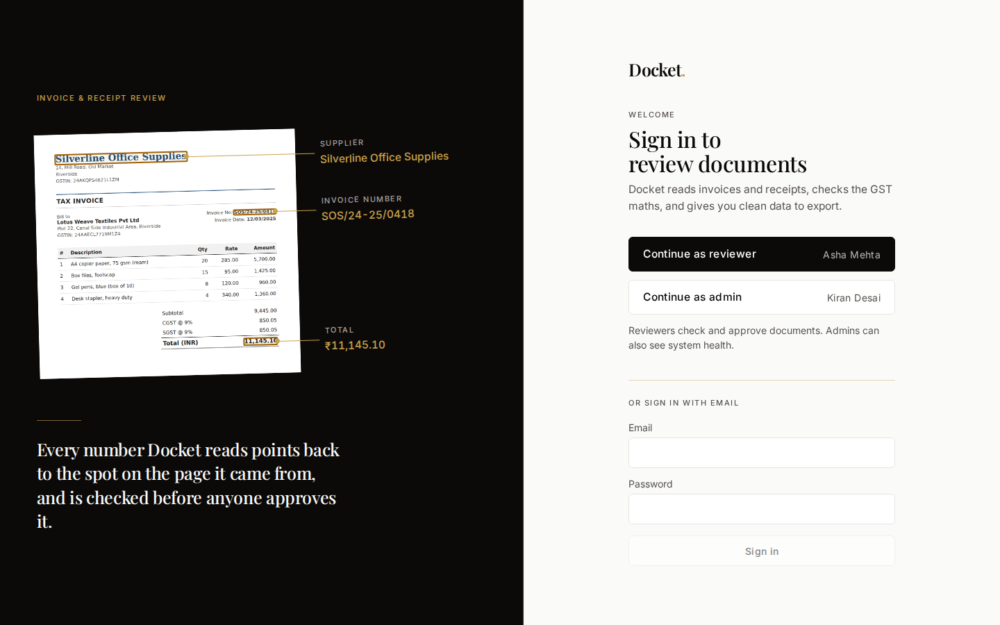
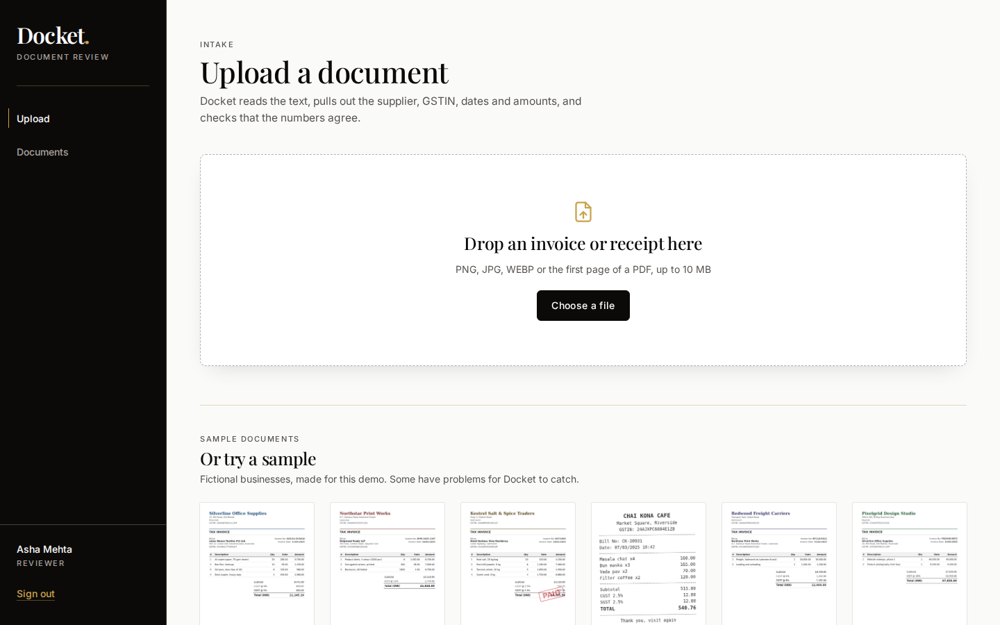
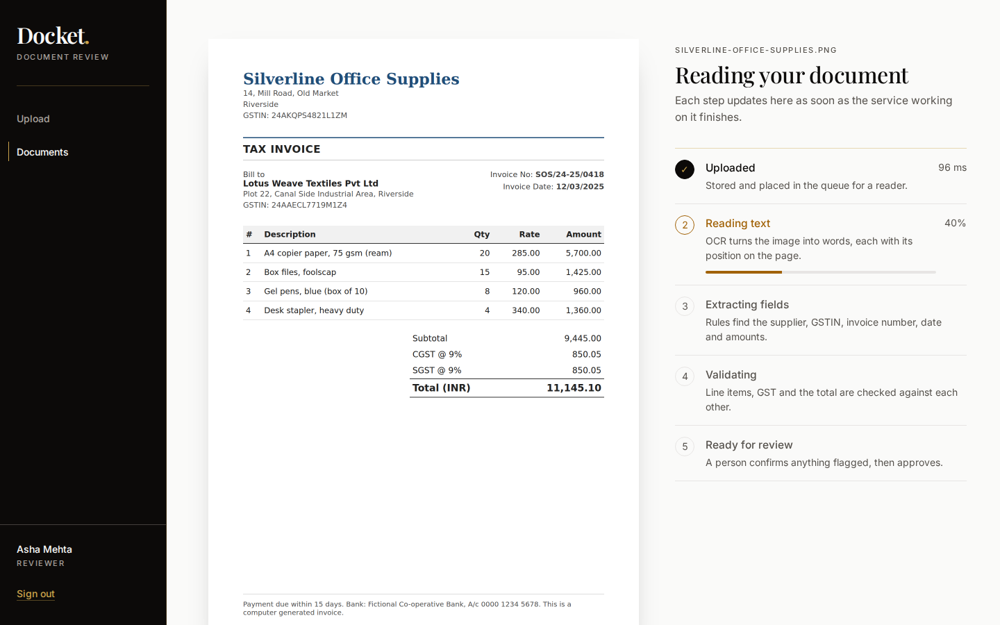
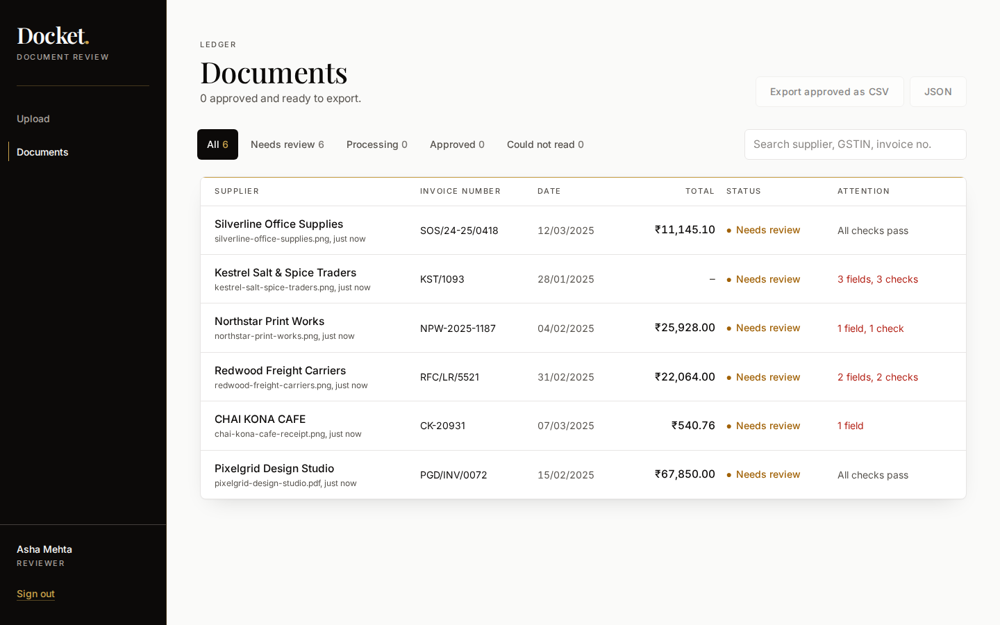
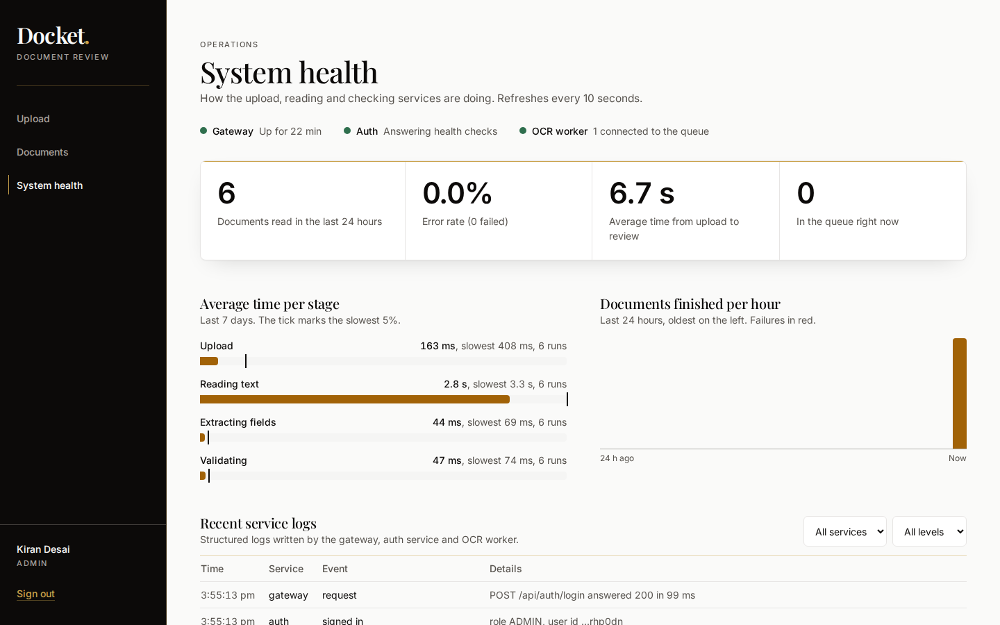
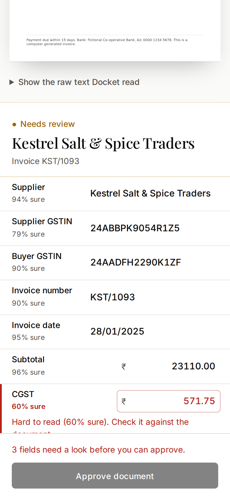

# Docket

[](docs/walkthrough.mp4)

**[Watch the narrated walkthrough video (docs/walkthrough.mp4, about 5 minutes, every feature)](docs/walkthrough.mp4)**

Docket reads business documents (invoices and receipts) and turns them into
checked, structured data. A reviewer uploads a scan, watches it move through
the pipeline live, fixes anything Docket was unsure about while seeing exactly
where each value came from on the page, and approves it. Approved data exports
as CSV or JSON. Admins get a system health page built from the services' own
logs and timings.



| | |
| --- | --- |
|  |  |
|  |  |
|  |  |

## What it does

1. **Sign in** as a reviewer or an admin (demo buttons, or email and password).
   Passwords are bcrypt-hashed; the auth service issues JWTs and the gateway
   checks the role on every API call.
2. **Upload** a PNG, JPG, WEBP or the first page of a PDF, or pick one of six
   sample documents.
3. **Pipeline**: Uploaded, Reading text (OCR), Extracting fields, Validating,
   Ready for review. Each step and the OCR progress are pushed to the browser
   over Socket.IO as the worker finishes them.
4. **Review**: the document on the left with a box over every value that was
   read; the fields on the right with OCR confidence. Hovering or focusing a
   field draws a line to its spot on the page; clicking a box selects its field.
   Low-confidence, missing and check-failing fields are flagged in red. Every
   correction, confirmation and approval is stored with who did it and when.
5. **Documents**: search (supplier, GSTIN, invoice number, file name), filter by
   status, export approved data as CSV or JSON.
6. **System health** (admin only): service status, documents read in 24 hours,
   error rate, average and 95th percentile time per stage, throughput per hour,
   and recent structured logs from all three services.

### Checks run on every document

- Required fields are present (supplier, GSTIN, invoice number, date, subtotal, total)
- Supplier and buyer GSTIN: shape, state code and the mod-36 check digit
- Invoice date is a real calendar date and not in the future
- Line items add up to the subtotal; quantity times rate matches each line
- CGST equals SGST
- Tax type matches the place of supply (same state: CGST + SGST; different states: IGST)
- Total tax is a standard GST rate of the subtotal (0.25, 3, 5, 12, 18 or 28%)
- Subtotal plus tax equals the total (within one rupee for rounding)

A reviewer must confirm or correct every flagged reading before approving. If a
business check still fails (for example a misprinted subtotal on the original
bill), the document can only be approved with a written note, which goes into
the history.

## Architecture

```
 browser (React + Vite + Tailwind, :5190)
    │  REST + Socket.IO
    ▼
 gateway (Express, :4300) ──HTTP──► auth service (Express, :4301)
    │  writes jobs, NOTIFY docket_jobs          bcrypt + JWT
    │  LISTEN docket_doc_events ──► Socket.IO
    ▼
 PostgreSQL (Prisma) ◄──────── OCR worker (tesseract.js)
    job table, documents,        LISTEN docket_jobs, claims jobs with
    fields, audit, stage runs,   SELECT … FOR UPDATE SKIP LOCKED,
    service logs                 NOTIFY docket_doc_events after each stage
```

- **npm workspaces, TypeScript end to end**: `apps/web`, `services/gateway`,
  `services/auth`, `services/worker`, `packages/core` (extraction and
  validation rules, shared by the worker, the gateway and the browser),
  `packages/db` (Prisma schema, client, LISTEN helper, logger).
- **Queue**: a Postgres table. The worker claims the oldest queued job in one
  `UPDATE … WHERE id = (SELECT … FOR UPDATE SKIP LOCKED LIMIT 1)` statement, so
  several workers can run without taking the same job. New jobs wake workers
  through `LISTEN/NOTIFY`; a 15 second poll covers missed notifications. A job
  held for more than 5 minutes by a worker that died is picked up again. Failed
  jobs retry up to 3 times, then the document is marked "Could not read".
- **Events**: the worker sends `pg_notify` after each stage; the gateway
  listens and relays to browsers over Socket.IO. No Kafka or other broker is
  used.
- **Logs and metrics**: each service writes structured JSON lines to stdout and
  a copy to the `ServiceLog` table. Stage timings come from `StageRun` rows. The
  health page reads both, and detects connected workers from
  `pg_stat_activity` (each worker's LISTEN connection is named `docket-worker`).

### OCR and extraction, honestly

- OCR is real: [tesseract.js](https://github.com/naptha/tesseract.js) running
  server-side in the worker, with the English model from
  `@tesseract.js-data/eng` read from `node_modules`. After `npm install` it
  runs fully offline.
- Field extraction is **rule-based**: regular expressions over OCR lines plus
  layout heuristics (the tallest line near the top is the supplier, the first
  GSTIN is the supplier's, money is the last amount on a labelled line, line
  items sit between the table header and the subtotal). There is no machine
  learning model. It works well on typed GST invoices and receipts like
  the samples, and will miss fields on unusual layouts, handwriting or poor
  photos. That is what the review step is for.
- Confidence is Tesseract's per-word confidence averaged over the words a value
  came from. Below 75% a field is flagged.
- PDFs: page one is rendered to PNG with `pdftoppm` (poppler-utils). Without it,
  image uploads still work and PDF uploads return a clear error.

## Running it

Requirements: Node 20+ (tested on 24), PostgreSQL 16 binaries, and optionally
`pdftoppm` (`sudo apt install poppler-utils`) for PDF uploads.

```bash
cp .env.example .env          # adjust PG_BIN / PGDATA_DIR / JWT_SECRET if needed
npm install                   # also generates the Prisma client
npm run db:init               # initdb + start a private cluster on port 54332, create db "docket"
npm run setup                 # apply migrations, seed the two demo users
npm run dev                   # auth, gateway, worker and web together
```

Open http://127.0.0.1:5190 and choose "Continue as reviewer".

Other commands:

| Command | What it does |
| --- | --- |
| `npm run db:start` / `npm run db:stop` | Start or stop the local Postgres cluster |
| `npm test` | Vitest: extraction on real OCR output of every sample, GSTIN, dates, every validation rule |
| `npm run typecheck` | `tsc --noEmit` in every workspace |
| `npm run samples` | Re-render the sample documents (needs Playwright; set `PLAYWRIGHT_DIR`) |
| `npx tsx scripts/record-walkthrough.mts` | Re-record `docs/walkthrough.mp4` (see the header of the script for the env vars) |

The local cluster uses `trust` authentication on 127.0.0.1 only. That is fine
for a demo on your own machine; use a password and TLS anywhere else.

Demo accounts (created by `npm run db:seed`):

| Role | Email | Password |
| --- | --- | --- |
| Reviewer | reviewer@docket.demo | review-docs-2025 |
| Admin | admin@docket.demo | admin-docs-2025 |

Ports: web 5190, gateway 4300, auth 4301, Postgres 54332.

## Sample documents

All six in `samples/` were generated for this demo (`scripts/make-samples.mjs`).
Every business, address and GSTIN is fictional.

| File | What it shows |
| --- | --- |
| silverline-office-supplies.png | Clean intra-state invoice, every check passes |
| northstar-print-works.png | Inter-state IGST invoice whose printed subtotal is ₹100 more than its lines |
| kestrel-salt-spice-traders.png | A "PAID" stamp over the totals: CGST misread, SGST and total not found |
| chai-kona-cafe-receipt.png | Thermal receipt; the GSTIN reads with low confidence |
| redwood-freight-carriers.png | GSTIN with a wrong check digit and the date 31/02/2025 |
| pixelgrid-design-studio.pdf | PDF upload, inter-state service invoice |

## Limitations

- Extraction rules are tuned for typed GST invoices in English. Other layouts,
  languages and handwriting will need more rules or a trained model.
- Only the first page of a PDF is read.
- Line items are shown and checked but not editable in the review screen;
  corrections are made on the header fields.
- Login rate limiting is in memory in the auth service, so it resets on restart
  and is not shared between multiple auth processes.
- Uploaded files are stored on local disk under `var/uploads`.
- Every signed-in user receives every pipeline event; there are no teams or
  per-document permissions.
- Design notes: [docs/design-notes.md](docs/design-notes.md).
